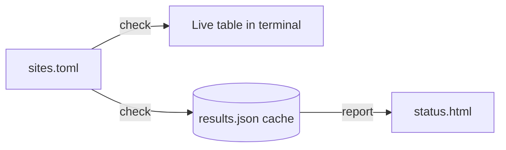

# DepGuard AI (Hacktoberfest 2026, Track 1: Best Use of Gemma 4)

**The problem.** Pinned, aging dependencies quietly break projects or carry known advisories (here: `Jinja2==2.11.3` no longer imports against a current MarkupSafe, and
the package index lists 8 advisories for that exact version). Developers need to know *which* dependencies are at risk, *where* they are used, *what to change*, and
*proof* that a change works before it touches their repository.

**What DepGuard does.** It analyses a real repository, explains each at-risk dependency with cited evidence, lets you choose **Repair**, **Ignore** or **Review later** per finding,
asks a **local Gemma 4** model for a concrete patch, validates it, **tests it against a baseline in an isolated copy and environment**, shows the diff and the results, and only
after your explicit approval applies it to a *working copy* and exports a patch or prepares a pull request. Everything ends in an evidence-backed **Dependency Exit Capsule**
(one per dependency plus a combined report; JSON, Markdown and HTML).

It never merges, force-pushes, or modifies the repository you analysed. Observed facts, package-index data, AI claims and executed test results are kept apart everywhere.

## Workflow (the dashboard is organised around exactly this)

| Step | What happens | Modules |
|---|---|---|
| 1. Repository | **ZIP upload** (validated before extraction), **local Git repository** (branch/dirty state read, uncommitted changes preserved), or **GitHub** (exact commit SHA recorded) | `repo_input.py`, `git_integration/github.py` |
| 2. Findings | deterministic scan, usage + impact graph, evidence-based severity, one finding per at-risk dependency with Repair / Ignore / Review later | `scanner.py`, `usage.py`, `impact.py`, `indicators.py`, `findings.py`, `metadata.py` |
| 3. Ask Gemma 4 | advice for **every** at-risk finding (small batches), schema-validated, may answer "no reliable recommendation"; all AI text is labelled unverified | `advisor.py` |
| 4. Repair | **Mode A** (you trigger one proposal) or **Mode B** (you enable automatic preparation for chosen findings; bounded retries). Diffs, reasons, evidence, nothing applied | `repair/` |
| 5. Verify | baseline vs patched tests in separate temp copies + virtual environments; exact commands, exit codes, durations, environment, failure kind | `verify.py`, `repair/planner.py` |
| 6. Publish | local patch export (`git apply` compatible) or a GitHub branch + pull request with **two separate approvals**; supplementary pre-publish checks | `git_integration/`, `prepublish/` |
| 7. Reports & capsule | schema-validated capsule, per-dependency capsules, downloads | `capsule.py`, `capsule.schema.json`, `report_html.py` |

Severity (documented in [`findings.py`](depguard/findings.py)): **critical** = the index lists an advisory for the exact version in use; **high** = baseline tests show an error naming the
package, Python 3.12/3.13 unsupported, yanked, or marked Inactive; **medium** = conflicting constraints, undeclared import, private API, deprecation warning;
**low** = inactivity or "no static import found" (signals, never proof). "No advisory listed" never means "secure".

## A real run on LinkWatch (recorded in this session; local Git repo, branch `main`, commit `d7941cb`)

* **11 findings**: 4 critical, 0 high, 2 medium, 5 low. The criticals are **index-listed advisories for the exact versions in use**, each with source URL and retrieval time:
  jinja2 2.11.3 (8), requests 2.31.0 (6), idna 2.7 (4), setuptools 75.8.0 (4). Medium: `certifi` imported but undeclared; `pydantic` pinned `==1.10.13` in requirements.txt but `>=2` in pyproject.toml.
* **Baseline** (original tests): **9 passed, 1 failed** (`soft_unicode` ImportError from Jinja2 2.11.3 / MarkupSafe).
* **Gemma 4 advised on all 6 at-risk findings** (after it was given the collected evidence; an earlier run without it said "keep requests" and the flaw was fixed). For jinja2 a Mode A repair
  produced a patch relaxing the pin to `Jinja2>=3.1.3` in both manifests. **Tested in isolation: 10 passed, 0 failed**, it fixed `test_report_renders_all_sites`, no regressions. It was applied only
  to a working copy (the original manifests still say `2.11.3`), exported as a patch, and recorded in a valid capsule. Passing tests do **not** prove full compatibility.
* An advisory-coverage check (added afterwards, unit-tested against the real advisory data) shows that `>=3.1.3` still permits releases the index lists as fixed only in 3.1.4 to 3.1.6; it was not re-run live.
* **Earlier recorded evidence** ([demo-output/](demo-output/)): a combined Gemma proposal that relaxed `setuptools` **failed verification** (pytest exit 4) and is recorded as a failure; a human-specified
  `Jinja2==3.1.6` experiment gave 10 passed / 0 failed in an isolated copy.
* **Not done live:** the GitHub branch/PR publication was never run against GitHub (it needs your token and a repository you control); it is covered by mocked tests only.

## Setup (Python 3.12 or 3.13; 3.14 is unsupported)

```bash
python -m venv .venv                                                  # macOS/Linux: .venv/bin/python
.venv\Scripts\python -m pip install -r depguard/requirements.txt      # jsonschema, packaging, pytest
ollama pull gemma4:e2b                                                # local model; never use the *-cloud tags
```

## Usage

```bash
.venv\Scripts\python -m depguard.web              # dashboard: http://127.0.0.1:8765/  (localhost only)
python -m depguard analyze . --out depguard-out   # the same read-only analysis from the command line (--metadata for advisories, --no-ai, --no-tests)
python -m depguard apply depguard-out/capsule.json --workdir ../copy      # legacy CLI: shows the diff, asks for 'yes'; never commits or pushes
```

Dashboard flags: `--offline` (no network of any kind), `--allow PATH` (extra scan root), `--allow-apply PATH`, `--port N`, `--no-browser`.

**GitHub.** Public repositories need no token. To read private repositories or publish, create a *fine-grained* token limited to the one repository with **Contents** and **Pull requests**
read/write and paste it on the Repository page. It is kept in memory only, sent only to `api.github.com`, redacted from every log, error and report, and dropped when you disconnect.
If you cannot push to the target (e.g. LinkWatch belongs to `rishrek`), fork it and open the fork, or use the exported patch.

## Safety model

* **The analysed repository is never modified.** Patches go to a separate working copy (a copy of your current tree *including uncommitted changes*); a patch records the commit or content fingerprint it was built on and becomes **stale** (renewed review required) if the files change.
* **Nothing is applied automatically**, in either repair mode. Apply needs the typed word `APPLY`, verification must have been attempted, and a failed/blocked patch needs an explicit acknowledgement. Rollback restores a snapshot.
* **Validation of every edit:** paths stay inside the working copy; only manifests and source files that use the dependency may change; no deletions or file creation; Python must still parse, TOML must stay valid; edits adding process/network/eval calls are refused; line endings are preserved exactly.
* **Publication has two approvals** (`PUBLISH` to push ONE commit on a NEW branch, `OPEN PR` to open the PR), re-checks that the base branch is still the analysed commit, verifies the bytes pushed equal the reviewed patch, never touches the default branch, never merges or force-pushes.
* **Inputs:** ZIPs are checked for traversal, absolute/reserved names, symlinks, size, entry count and compression ratio before extraction. Scanning parses files only; a **full analysis installs requirements and runs the tests, which executes the repository's code** (a venv is not a sandbox), so for ZIP/GitHub inputs it needs separate confirmation.
* **Dashboard:** binds `127.0.0.1`, rejects foreign `Host`/`Origin` and POSTs without an `X-DepGuard` header, no shell endpoint, paths restricted to authorized roots, one long operation at a time.

## Gemma 4 runtime (verified on this machine)

| | |
|---|---|
| Model | `gemma4:e2b` (Ollama tag; `ollama show`: architecture gemma4, 4.6B parameters, Q4_K_M, context 131072) |
| Runtime / access | Ollama 0.40.4 (model requires ≥ 0.30.9), local HTTP API on 127.0.0.1:11434; no hosted API, no paid service, no cloud |
| Checked | model details via `ollama show`, a real chat inference per run (`runtime_check` in each capsule), and whether `nvidia-smi` sees a GPU (that alone does not show that Ollama uses it; `ollama ps` does). Measured here on a 15 GB RAM laptop: ≈ 21 tokens/s with the model on the **CPU**, because the Ollama instance started at login had not detected the RTX 3050 (its log lists only the CPU). A freshly started Ollama detected the GPU (CUDA, 4 GB) and the same advice request generated ≈ 38 tokens/s. If `ollama ps` shows 100% CPU, restart Ollama |
| Source | https://ollama.com/library/gemma4 |
| License | Apache 2.0 per the license text bundled with the local model. **Not cross-checked** against Google's official terms |
| Role | advice for every at-risk finding; single-finding repair proposals with exact `find`/`replace` edits, assumptions, concerns, suggested tests; bounded revision using a failed test's output as data. Output is schema-validated and **never trusted**: edits are validated, then tested |

If the model is unavailable the capsule says `blocked`/`partial`; deterministic scanning and reporting still work and nothing else is presented as AI. A 4.6B model is conservative and sometimes wrong
(it listed file names as "replacement candidates", which are now filtered); every AI statement stays unverified until tested.

## Architecture

Single Python package `depguard/` with a stdlib `http.server` dashboard (plain HTML/CSS/JS, no build step) instead of Flask: the project is zero-dependency apart from `jsonschema`/`packaging`, the server is ~600 lines with
its own security tests, and nothing in the product needs a framework. Layers: **inputs** (`repo_input`, `acquire`, `git_integration/github`) → **deterministic evidence** (`scanner`, `usage`, `impact`, `metadata`, `indicators`, `findings`, `health`) →
**Gemma 4** (`advisor`) → **repair** (`repair/patch`, `repair/planner`, `repair/state`, `repair/advisory`) → **verification** (`verify`) → **pre-publish** (`prepublish/*`) → **publication** (`git_integration/pull_request`) →
**capsule** (`capsule`, `report_html`) → **web** (`web/server`, `web/api`, `web/project`, `web/static/*`). Details: [depguard/README.md](depguard/README.md).

## Tests

```bash
pytest depguard/tests -k "not live"        # 366 tests on Python 3.12.10 and on 3.13.14: mocked AI/GitHub/verifier, offline, no network
pytest depguard/tests/test_live_gemma.py   # 1 live Gemma 4 test (skips if the model is absent)
pytest                                     # LinkWatch's own suite on the ORIGINAL tree: 9 passed, 1 failed (the known Jinja2 failure)
```

## Limitations (what is not verified or not provided)

* **No container isolation and no CPU/memory limits:** verification uses a virtual environment inside a temporary copy with a wall-clock timeout and capped output only. Hostile code is not safely contained.
* **Advisory data is index-listed, not an audit:** it needs a network fetch (opt-in, cached with source and time); offline it reads "not checked". Release recency uses the latest upload date only; repository activity is never checked.
* **Static analysis only:** dynamic imports, plugins, reflection and tests that do not import the code are not seen; "no static import found" is not proof of non-use.
* **Passing tests prove only what the project's own tests cover.** Partial results (skipped tests, fewer tests) are labelled partial.
* **No lockfile support** (LinkWatch has none); Pipfile/poetry/uv/setup.py/package.json are detected and reported as unsupported rather than parsed.
* **GitHub publication is mock-tested only.** The ZIP, local and GitHub-download inputs, the repair modes and the verification were exercised for real on LinkWatch.
* `gemma4:e2b` can propose weak fixes (e.g. a lower bound that still permits affected releases); the checks above exist to expose that, not to guarantee good fixes.

## License

MIT (see [LICENSE](LICENSE)), unchanged from the starter. Gemma 4 weights are not redistributed.

---

# About the analyzed project: LinkWatch (original README)

<div align="center">

# 🔭 linkwatch

**Keep an eye on your websites from the terminal.**

A small, friendly link & uptime checker: list your sites in one file, run one command,
and get a live status table plus a clean HTML status page you can host anywhere.


[Quick start](#-quick-start) •
[Usage](#-usage) •
[Configuration](#%EF%B8%8F-configuration) •
[How it works](#-how-it-works) •
[Tests](#-running-the-tests)

</div>

---

## ✨ Features

- 📋 **One config file**: list every site you care about in `sites.toml`
- ⚡ **Live terminal table**: watch results fill in as each site is checked
- 🟢 **Clear status**: UP/DOWN, HTTP status code, response time and page title
- 🕒 **Last-Modified tracking**: see when a page was last updated (when the server reports it)
- 💾 **Cached results**: the last run is saved, so you can build reports any time
- 🌐 **HTML status page**: one command turns your results into a shareable `status.html`
- 🐳 **Docker ready**: run everything without touching your local Python

---

## 🖥️ Preview

```text
$ python -m linkwatch.cli check
                                    My sites
┏━━━━━━━━━┳━━━━━━━━┳━━━━━━┳━━━━━━━━┳━━━━━━━━━━━━━━━━━━━━━━━━━━━━━━━━━┓
┃ Site    ┃ Status ┃ Code ┃   Time ┃ Title                           ┃
┡━━━━━━━━━╇━━━━━━━━╇━━━━━━╇━━━━━━━━╇━━━━━━━━━━━━━━━━━━━━━━━━━━━━━━━━━┩
│ Python  │ UP     │  200 │ 113 ms │ Welcome to Python.org           │
│ PyPI    │ UP     │  200 │  59 ms │ PyPI · The Python Package Index │
│ Example │ UP     │  200 │ 204 ms │ Example Domain                  │
│ GitHub  │ UP     │  200 │ 236 ms │ GitHub                          │
└─────────┴────────┴──────┴────────┴─────────────────────────────────┘
4/4 sites up, results saved to ~/.cache/linkwatch/results.json
```

---

## 🚀 Quick start

You only need **one** of the two options below.

### Option A: Docker (no Python setup needed)

```bash
git clone https://github.com/rishrek/linkwatch.git
cd linkwatch
make docker-build
docker run --rm -it linkwatch python -m linkwatch.cli check
```

### Option B: Local Python 3.12

```bash
git clone https://github.com/rishrek/linkwatch.git
cd linkwatch
make setup                    # creates .venv and installs everything (one time)
source .venv/bin/activate     # do this in every new terminal
python -m linkwatch.cli check
```

<details>
<summary><b>On Windows, or without <code>make</code>?</b></summary>

```powershell
py -3.12 -m venv .venv
.venv\Scripts\activate
pip install -r requirements.txt -r requirements-dev.txt
python -m linkwatch.cli check
```

If your Python 3.12 has a different name on macOS/Linux, pass it to make:
`make setup PYTHON=/path/to/python3.12`

</details>

---

## 📖 Usage

| Command | What it does |
|---------|--------------|
| `python -m linkwatch.cli check` | Checks every site, shows the live table and saves the results |
| `python -m linkwatch.cli report` | Builds `status.html` from the last saved results |
| `python -m linkwatch.cli info` | Shows where the templates and cached results live |
| `python -m linkwatch.cli --help` | Lists all commands and options |

### Options

| Command | Option | Default | Description |
|---------|--------|---------|-------------|
| `check` | `--config PATH` | `sites.toml` | Use a different sites file |
| `report` | `-o, --output PATH` | `status.html` | Where to write the HTML page |
| `report` | `--title TEXT` | `linkwatch` | Heading shown on the status page |

### A typical session

```bash
python -m linkwatch.cli check                     # 1. check your sites
python -m linkwatch.cli report -o status.html     # 2. build the status page
open status.html                                  # 3. view it (xdg-open on Linux)
```

---

## ⚙️ Configuration

All sites live in **`sites.toml`** in the project folder:

```toml
title = "My sites"

[[sites]]
name = "Python"
url = "https://www.python.org"

[[sites]]
name = "Example"
url = "https://example.com"
```

| Key | Required | Description |
|-----|----------|-------------|
| `title` | no | Heading shown above the terminal table |
| `[[sites]]` | yes | One block per site you want to check |
| `name` | yes | Short label for the site |
| `url` | yes | Full address, must start with `http://` or `https://` |

To add a site, copy a `[[sites]]` block and change the name and URL.

### Where results are stored

| System | Location |
|--------|----------|
| macOS | `~/Library/Caches/linkwatch/results.json` |
| Linux | `~/.cache/linkwatch/results.json` |
| Windows | `%LOCALAPPDATA%\linkwatch\linkwatch\Cache\results.json` |

Set the `LINKWATCH_CACHE_DIR` environment variable to keep results somewhere else.

---

## 🧠 How it works



1. **Load**: `sites.toml` is read and validated (every site needs a name and a valid URL).
2. **Check**: each site gets an HTTP GET request, and linkwatch records the status code, response time, page title and `Last-Modified` header.
3. **Save**: results are written as JSON to your cache folder.
4. **Report**: the saved results are rendered into a standalone HTML page with a summary of what's up and what's down.

### Project structure

```text
linkwatch/
├── linkwatch/
│   ├── cli.py            # commands: check, report, info
│   ├── config.py         # reads and validates sites.toml
│   ├── checker.py        # visits each site and collects results
│   ├── encoding.py       # page charset detection and title extraction
│   ├── dates.py          # Last-Modified parsing
│   ├── http_patch.py     # default request headers
│   ├── cache.py          # saves and loads results.json
│   ├── report.py         # builds the HTML status page
│   ├── resources.py      # locates the bundled templates
│   └── templates/
│       └── status.html.j2
├── tests/                # pytest suite with a tiny local test server
├── sites.toml            # your list of sites
├── requirements.txt      # app dependencies
├── requirements-dev.txt  # test dependencies
├── Dockerfile
└── Makefile
```

---

## 🧪 Running the tests

The tests start a tiny local web server, so they don't depend on real websites.

```bash
make test            # locally (activate .venv first)
make docker-test     # inside Docker (run make docker-build first)
```

### Make targets

| Target | Description |
|--------|-------------|
| `make setup` | Create `.venv` and install all dependencies |
| `make test` | Run the pytest suite |
| `make test-nose` | Run the suite with nose |
| `make docker-build` | Build the Docker image |
| `make docker-test` | Run the tests inside Docker |

---

## 🤝 Contributing

Ideas, bug reports and pull requests are welcome. Fork the repo, create a branch,
and open a PR. Please run `make test` before submitting.

## 📄 License

Released under the [MIT License](LICENSE).
